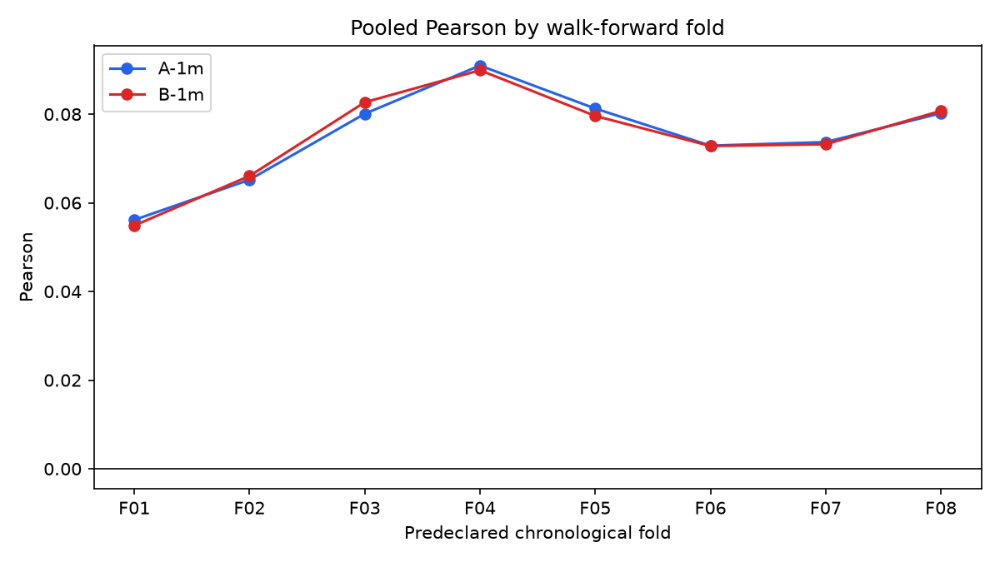
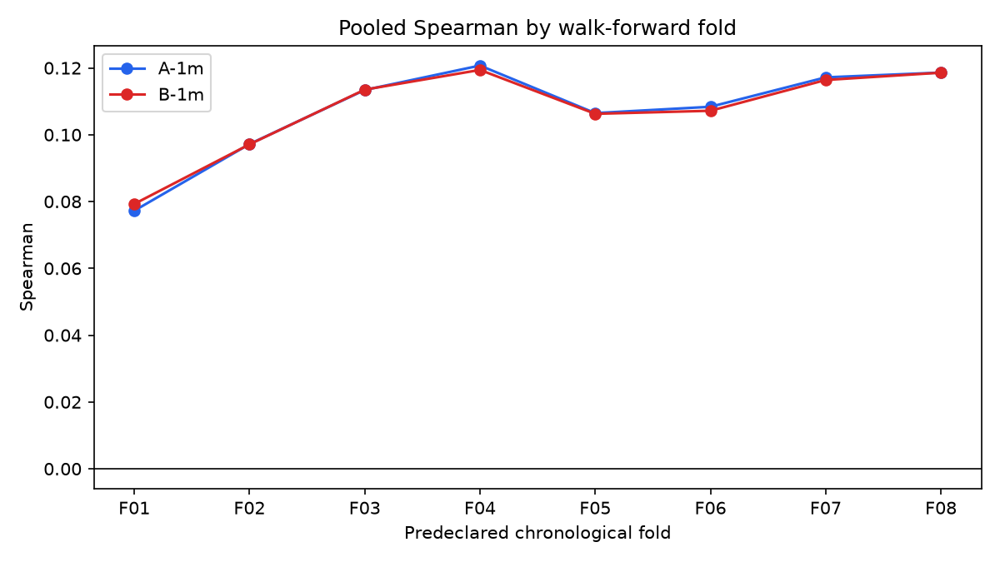
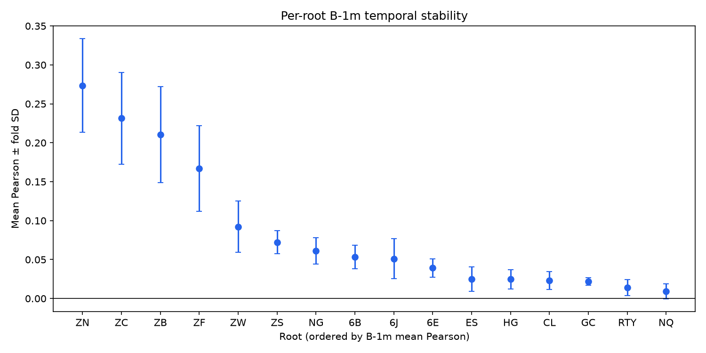
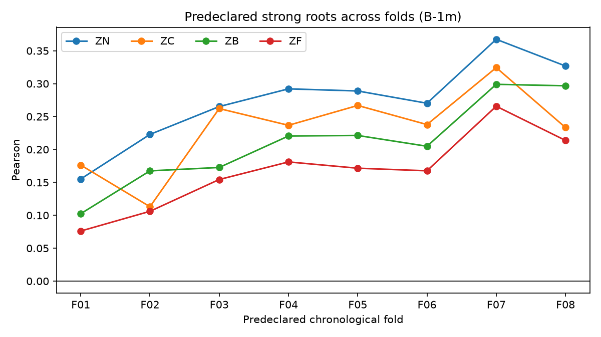

# Phase 2.2 Rolling Walk-Forward Stability Study

**Status: COMPLETE. Eight folds were predeclared before fitting. Phase 2 and Phase 2.1 data, models, metrics, and reports remain unchanged.**

## Objective

Determine whether the small one-minute predictive relationship found in Phase 2.1 remains positive and reasonably stable through different chronological market periods. This is historical temporal replication, not model invention, feature selection, strategy research, or a new pristine final holdout.

## Frozen experimental design

- A-1m: the original 35 own-market features.
- B-1m: the same 35 features plus the frozen 18 exact-UTC NQ/ES/ZN/CL/GC/6E returns at 1/5/15 minutes.
- Target: exact-time, same-segment `future_return_1m`.
- Model: HGB with `learning_rate=0.08`, `max_iter=150`, `max_leaf_nodes=31`, `min_samples_leaf=100`, `l2_regularization=0.1`, seed 42.
- Training cap: 200,000 deterministic evenly spaced observations/root; all available rows when below the cap.
- Every fold refits median imputation and root one-hot encoding on that fold's training sample only.
- No hyperparameter search, feature selection, relative C features, new indicators, new anchors, or target changes.

## Fold definitions

| Fold | Training start | Training end exclusive | Purge interval | Evaluation start | Evaluation end exclusive | Selected train | Evaluation N |
|---|---|---|---|---|---|---:|---:|
| fold_01 | 2021-09-23T00:00:00+00:00 | 2022-09-22T22:45:00+00:00 | [2022-09-22T22:45:00+00:00, 2022-09-23T01:15:00+00:00) | 2022-09-23T01:15:00+00:00 | 2023-03-23T00:00:00+00:00 | 3,187,416 | 2,403,633 |
| fold_02 | 2021-09-23T00:00:00+00:00 | 2023-03-22T22:45:00+00:00 | [2023-03-22T22:45:00+00:00, 2023-03-23T01:15:00+00:00) | 2023-03-23T01:15:00+00:00 | 2023-09-23T00:00:00+00:00 | 3,200,000 | 2,450,762 |
| fold_03 | 2021-09-23T00:00:00+00:00 | 2023-09-22T22:45:00+00:00 | [2023-09-22T22:45:00+00:00, 2023-09-23T01:15:00+00:00) | 2023-09-23T01:15:00+00:00 | 2024-03-23T00:00:00+00:00 | 3,200,000 | 2,376,645 |
| fold_04 | 2021-09-23T00:00:00+00:00 | 2024-03-22T22:45:00+00:00 | [2024-03-22T22:45:00+00:00, 2024-03-23T01:15:00+00:00) | 2024-03-23T01:15:00+00:00 | 2024-09-23T00:00:00+00:00 | 3,200,000 | 2,366,257 |
| fold_05 | 2021-09-23T00:00:00+00:00 | 2024-09-22T22:45:00+00:00 | [2024-09-22T22:45:00+00:00, 2024-09-23T01:15:00+00:00) | 2024-09-23T01:15:00+00:00 | 2025-03-23T00:00:00+00:00 | 3,200,000 | 2,365,420 |
| fold_06 | 2021-09-23T00:00:00+00:00 | 2025-03-22T22:45:00+00:00 | [2025-03-22T22:45:00+00:00, 2025-03-23T01:15:00+00:00) | 2025-03-23T01:15:00+00:00 | 2025-09-23T00:00:00+00:00 | 3,200,000 | 2,362,339 |
| fold_07 | 2021-09-23T00:00:00+00:00 | 2025-09-22T22:45:00+00:00 | [2025-09-22T22:45:00+00:00, 2025-09-23T01:15:00+00:00) | 2025-09-23T01:15:00+00:00 | 2026-03-23T00:00:00+00:00 | 3,200,000 | 2,305,976 |
| fold_08 | 2021-09-23T00:00:00+00:00 | 2026-03-22T22:45:00+00:00 | [2026-03-22T22:45:00+00:00, 2026-03-23T01:15:00+00:00) | 2026-03-23T01:15:00+00:00 | 2026-09-23T00:00:00+00:00 | 3,200,000 | 2,407,869 |

The declaration below was saved before training; performance did not alter a boundary or count. Fold 1 uses all 187,416 available ZW rows; every other root/fold reaches 200,000.

### fold_01 per-root declaration

| Root | Eligible train | Selected train | Evaluation N |
|---|---:|---:|---:|
| NQ | 353,942 | 200,000 | 173,587 |
| ES | 353,920 | 200,000 | 173,605 |
| RTY | 337,386 | 200,000 | 165,555 |
| ZF | 321,111 | 200,000 | 155,248 |
| ZN | 331,514 | 200,000 | 162,052 |
| ZB | 308,951 | 200,000 | 143,650 |
| CL | 346,288 | 200,000 | 170,179 |
| NG | 288,313 | 200,000 | 144,283 |
| GC | 347,300 | 200,000 | 169,393 |
| HG | 329,722 | 200,000 | 163,736 |
| 6E | 342,134 | 200,000 | 171,051 |
| 6J | 339,457 | 200,000 | 169,778 |
| 6B | 315,069 | 200,000 | 161,331 |
| ZC | 213,016 | 200,000 | 91,357 |
| ZS | 228,207 | 200,000 | 106,405 |
| ZW | 187,416 | 187,416 | 82,423 |

### fold_02 per-root declaration

| Root | Eligible train | Selected train | Evaluation N |
|---|---:|---:|---:|
| NQ | 527,604 | 200,000 | 179,577 |
| ES | 527,600 | 200,000 | 179,301 |
| RTY | 503,014 | 200,000 | 168,567 |
| ZF | 476,410 | 200,000 | 154,757 |
| ZN | 493,611 | 200,000 | 161,889 |
| ZB | 452,612 | 200,000 | 141,989 |
| CL | 516,550 | 200,000 | 174,438 |
| NG | 432,593 | 200,000 | 142,481 |
| GC | 516,768 | 200,000 | 173,240 |
| HG | 493,531 | 200,000 | 163,954 |
| 6E | 513,262 | 200,000 | 171,735 |
| 6J | 509,306 | 200,000 | 173,062 |
| 6B | 476,480 | 200,000 | 153,996 |
| ZC | 304,433 | 200,000 | 99,271 |
| ZS | 334,681 | 200,000 | 117,276 |
| ZW | 269,888 | 200,000 | 95,229 |

### fold_03 per-root declaration

| Root | Eligible train | Selected train | Evaluation N |
|---|---:|---:|---:|
| NQ | 707,331 | 200,000 | 175,011 |
| ES | 707,051 | 200,000 | 174,782 |
| RTY | 671,727 | 200,000 | 167,387 |
| ZF | 631,309 | 200,000 | 152,734 |
| ZN | 655,650 | 200,000 | 160,689 |
| ZB | 594,734 | 200,000 | 141,716 |
| CL | 691,130 | 200,000 | 169,771 |
| NG | 575,121 | 200,000 | 143,573 |
| GC | 690,156 | 200,000 | 172,745 |
| HG | 657,602 | 200,000 | 162,557 |
| 6E | 685,145 | 200,000 | 169,294 |
| 6J | 682,518 | 200,000 | 168,431 |
| 6B | 630,598 | 200,000 | 153,075 |
| ZC | 403,755 | 200,000 | 80,738 |
| ZS | 452,024 | 200,000 | 104,657 |
| ZW | 365,161 | 200,000 | 79,485 |

### fold_04 per-root declaration

| Root | Eligible train | Selected train | Evaluation N |
|---|---:|---:|---:|
| NQ | 882,342 | 200,000 | 176,215 |
| ES | 881,833 | 200,000 | 176,056 |
| RTY | 839,114 | 200,000 | 163,208 |
| ZF | 784,043 | 200,000 | 148,979 |
| ZN | 816,339 | 200,000 | 157,364 |
| ZB | 736,450 | 200,000 | 135,376 |
| CL | 860,901 | 200,000 | 169,667 |
| NG | 718,694 | 200,000 | 137,619 |
| GC | 862,901 | 200,000 | 173,214 |
| HG | 820,159 | 200,000 | 165,797 |
| 6E | 854,439 | 200,000 | 166,926 |
| 6J | 850,949 | 200,000 | 168,632 |
| 6B | 783,673 | 200,000 | 145,550 |
| ZC | 484,493 | 200,000 | 83,827 |
| ZS | 556,681 | 200,000 | 107,910 |
| ZW | 444,646 | 200,000 | 89,917 |

### fold_05 per-root declaration

| Root | Eligible train | Selected train | Evaluation N |
|---|---:|---:|---:|
| NQ | 1,058,482 | 200,000 | 174,179 |
| ES | 1,057,814 | 200,000 | 174,125 |
| RTY | 1,002,258 | 200,000 | 161,454 |
| ZF | 932,970 | 200,000 | 144,902 |
| ZN | 973,664 | 200,000 | 155,969 |
| ZB | 871,797 | 200,000 | 135,563 |
| CL | 1,030,505 | 200,000 | 169,188 |
| NG | 856,282 | 200,000 | 148,826 |
| GC | 1,036,042 | 200,000 | 172,274 |
| HG | 985,904 | 200,000 | 164,607 |
| 6E | 1,021,303 | 200,000 | 170,591 |
| 6J | 1,019,506 | 200,000 | 170,798 |
| 6B | 929,201 | 200,000 | 153,567 |
| ZC | 568,320 | 200,000 | 82,030 |
| ZS | 664,591 | 200,000 | 102,553 |
| ZW | 534,563 | 200,000 | 84,794 |

### fold_06 per-root declaration

| Root | Eligible train | Selected train | Evaluation N |
|---|---:|---:|---:|
| NQ | 1,232,811 | 200,000 | 177,622 |
| ES | 1,232,089 | 200,000 | 177,659 |
| RTY | 1,163,845 | 200,000 | 166,689 |
| ZF | 1,077,987 | 200,000 | 146,001 |
| ZN | 1,129,731 | 200,000 | 155,449 |
| ZB | 1,007,431 | 200,000 | 135,105 |
| CL | 1,199,831 | 200,000 | 170,341 |
| NG | 1,005,139 | 200,000 | 142,994 |
| GC | 1,208,464 | 200,000 | 175,316 |
| HG | 1,150,636 | 200,000 | 147,930 |
| 6E | 1,192,029 | 200,000 | 173,291 |
| 6J | 1,190,454 | 200,000 | 172,738 |
| 6B | 1,082,840 | 200,000 | 153,252 |
| ZC | 650,417 | 200,000 | 81,943 |
| ZS | 767,215 | 200,000 | 102,874 |
| ZW | 619,409 | 200,000 | 83,135 |

### fold_07 per-root declaration

| Root | Eligible train | Selected train | Evaluation N |
|---|---:|---:|---:|
| NQ | 1,410,358 | 200,000 | 172,668 |
| ES | 1,409,673 | 200,000 | 172,736 |
| RTY | 1,330,476 | 200,000 | 166,322 |
| ZF | 1,223,981 | 200,000 | 135,157 |
| ZN | 1,285,164 | 200,000 | 147,816 |
| ZB | 1,142,531 | 200,000 | 124,191 |
| CL | 1,370,111 | 200,000 | 167,300 |
| NG | 1,148,108 | 200,000 | 152,973 |
| GC | 1,383,705 | 200,000 | 171,479 |
| HG | 1,298,546 | 200,000 | 157,828 |
| 6E | 1,365,267 | 200,000 | 166,276 |
| 6J | 1,363,140 | 200,000 | 165,681 |
| 6B | 1,236,072 | 200,000 | 146,908 |
| ZC | 732,360 | 200,000 | 79,958 |
| ZS | 870,089 | 200,000 | 98,899 |
| ZW | 702,544 | 200,000 | 79,784 |

### fold_08 per-root declaration

| Root | Eligible train | Selected train | Evaluation N |
|---|---:|---:|---:|
| NQ | 1,583,101 | 200,000 | 179,951 |
| ES | 1,582,484 | 200,000 | 180,013 |
| RTY | 1,496,847 | 200,000 | 173,438 |
| ZF | 1,359,087 | 200,000 | 142,363 |
| ZN | 1,432,959 | 200,000 | 151,672 |
| ZB | 1,266,695 | 200,000 | 129,456 |
| CL | 1,537,460 | 200,000 | 175,338 |
| NG | 1,301,054 | 200,000 | 149,688 |
| GC | 1,555,259 | 200,000 | 175,933 |
| HG | 1,456,383 | 200,000 | 156,662 |
| 6E | 1,531,594 | 200,000 | 170,254 |
| 6J | 1,528,865 | 200,000 | 163,506 |
| 6B | 1,382,993 | 200,000 | 145,574 |
| ZC | 812,360 | 200,000 | 97,430 |
| ZS | 969,051 | 200,000 | 110,393 |
| ZW | 782,364 | 200,000 | 106,198 |

## Leakage safeguards

Each fold trains strictly before its evaluation window. A 150-minute unused interval implements 75 minutes on each side of the boundary. Exact next-minute labels and anchor joins remain same-timestamp/same-segment; no next-available row, as-of join, forward fill, or rollover crossing is allowed. Label columns are rejected from `X`. The runner asserts actual train and evaluation counts against the predeclared files and saves a separate preprocessor/model per fold.

Phase 2.1 already examined later portions of this history. These are replication windows over known historical data, not eight new untouched tests.

## A-1m walk-forward results

| Fold | N | MAE | RMSE | R² | Pearson | Spearman | Direction accuracy |
|---|---:|---:|---:|---:|---:|---:|---:|
| fold_01 | 2,403,633 | 0.000280105 | 0.000547247 | 0.00250197 | 0.0561449 | 0.0772526 | 41.880% |
| fold_02 | 2,450,762 | 0.00021543 | 0.00042674 | 0.00341063 | 0.065206 | 0.0972023 | 39.910% |
| fold_03 | 2,376,645 | 0.000203954 | 0.000406003 | 0.00471075 | 0.0800924 | 0.113388 | 39.580% |
| fold_04 | 2,366,257 | 0.00020991 | 0.000412137 | 0.00560705 | 0.0909686 | 0.120707 | 39.942% |
| fold_05 | 2,365,420 | 0.000215529 | 0.000414736 | 0.00502881 | 0.0812641 | 0.106469 | 40.187% |
| fold_06 | 2,362,339 | 0.000227075 | 0.000461481 | 0.00424883 | 0.0728945 | 0.108365 | 40.946% |
| fold_07 | 2,305,976 | 0.000243652 | 0.000499072 | 0.00421155 | 0.0737025 | 0.117167 | 41.240% |
| fold_08 | 2,407,869 | 0.000235509 | 0.000458523 | 0.0050201 | 0.0802136 | 0.118602 | 41.056% |

## B-1m walk-forward results

| Fold | N | MAE | RMSE | R² | Pearson | Spearman | Direction accuracy |
|---|---:|---:|---:|---:|---:|---:|---:|
| fold_01 | 2,403,633 | 0.000280164 | 0.000547274 | 0.00240401 | 0.0548723 | 0.079273 | 42.064% |
| fold_02 | 2,450,762 | 0.000215644 | 0.000426713 | 0.00353542 | 0.0660614 | 0.0971171 | 39.965% |
| fold_03 | 2,376,645 | 0.000203996 | 0.000405969 | 0.00487969 | 0.0826824 | 0.113494 | 39.711% |
| fold_04 | 2,366,257 | 0.000209977 | 0.000412147 | 0.00556197 | 0.0899072 | 0.119396 | 39.956% |
| fold_05 | 2,365,420 | 0.000215519 | 0.000414776 | 0.00483473 | 0.0796068 | 0.106256 | 40.546% |
| fold_06 | 2,362,339 | 0.000227081 | 0.000461503 | 0.00415414 | 0.0728121 | 0.107166 | 40.857% |
| fold_07 | 2,305,976 | 0.000243623 | 0.000499089 | 0.00414387 | 0.0732074 | 0.116385 | 41.229% |
| fold_08 | 2,407,869 | 0.000235502 | 0.000458511 | 0.00507224 | 0.0807456 | 0.118572 | 41.063% |

## A vs B fold-by-fold comparison

| Fold | B-A Pearson | B-A Spearman | B-A R² | Pearson winner |
|---|---:|---:|---:|---|
| fold_01 | -0.00127255 | 0.00202037 | -9.79596e-05 | A |
| fold_02 | 0.000855425 | -8.52166e-05 | 0.000124788 | B |
| fold_03 | 0.00258994 | 0.000106223 | 0.00016894 | B |
| fold_04 | -0.00106148 | -0.00131125 | -4.50741e-05 | A |
| fold_05 | -0.00165733 | -0.000213057 | -0.000194085 | A |
| fold_06 | -8.24326e-05 | -0.00119894 | -9.46995e-05 | A |
| fold_07 | -0.000495104 | -0.000781824 | -6.76831e-05 | A |
| fold_08 | 0.000532004 | -2.98433e-05 | 5.21403e-05 | B |

B beat A on Pearson in 3/8 folds, Spearman in 2/8, and R² in 3/8. Mean B-A Pearson was `-7.39412e-05`. The small Phase 2.1 B advantage does not repeat consistently; the raw cross-market increment is best treated as noise at this resolution.

## Per-market stability

### A-1m root stability

| Root | Mean Pearson | Median Pearson | Pearson SD | Worst | Best | Positive folds | Mean Spearman | Positive Spearman folds | Avg rank | Rank range |
|---|---:|---:|---:|---:|---:|---:|---:|---:|---:|---|
| ZN | 0.273651 | 0.28144 | 0.060705 | 0.151921 | 0.367401 | 8/8 | 0.315914 | 8/8 | 1.12 | 1-2 |
| ZC | 0.231291 | 0.2395 | 0.059985 | 0.110073 | 0.324902 | 8/8 | 0.272545 | 8/8 | 2.12 | 1-3 |
| ZB | 0.211425 | 0.21337 | 0.0621453 | 0.102487 | 0.30335 | 8/8 | 0.244222 | 8/8 | 2.75 | 2-3 |
| ZF | 0.167018 | 0.171514 | 0.0546044 | 0.0720305 | 0.262674 | 8/8 | 0.214275 | 8/8 | 4.00 | 4-4 |
| ZW | 0.0928864 | 0.0827727 | 0.0346746 | 0.0525641 | 0.159123 | 8/8 | 0.124033 | 8/8 | 6.00 | 5-8 |
| NG | 0.0611495 | 0.0630727 | 0.0169347 | 0.0309312 | 0.087412 | 8/8 | 0.100733 | 8/8 | 6.62 | 5-10 |
| ZS | 0.0691635 | 0.0740791 | 0.0157349 | 0.040306 | 0.0895441 | 8/8 | 0.0977794 | 8/8 | 6.88 | 5-10 |
| 6B | 0.0513092 | 0.0495485 | 0.014926 | 0.0230192 | 0.0748438 | 8/8 | 0.068886 | 8/8 | 8.25 | 7-11 |
| 6J | 0.0511328 | 0.0479583 | 0.0244362 | 0.00704132 | 0.0996717 | 8/8 | 0.087007 | 8/8 | 9.00 | 5-15 |
| 6E | 0.0390803 | 0.0382172 | 0.0114616 | 0.0219055 | 0.0558225 | 8/8 | 0.0570779 | 8/8 | 10.38 | 9-12 |
| ES | 0.0257032 | 0.0214677 | 0.0145688 | 0.00571152 | 0.050271 | 8/8 | 0.051198 | 8/8 | 11.75 | 7-14 |
| HG | 0.0238459 | 0.0258144 | 0.0102152 | 0.0018913 | 0.0379766 | 8/8 | 0.0465436 | 8/8 | 11.75 | 8-14 |
| GC | 0.0222839 | 0.0247357 | 0.00529478 | 0.0111899 | 0.0278522 | 8/8 | 0.0356057 | 8/8 | 12.50 | 9-14 |
| CL | 0.0212113 | 0.0266951 | 0.0143743 | -0.0025077 | 0.0381445 | 7/8 | 0.0576861 | 8/8 | 12.62 | 10-16 |
| RTY | 0.0134825 | 0.0138017 | 0.00895465 | -0.00460847 | 0.025453 | 7/8 | 0.029817 | 8/8 | 14.88 | 14-16 |
| NQ | 0.00942498 | 0.0122415 | 0.00689648 | -0.00474199 | 0.0171097 | 7/8 | 0.0253054 | 8/8 | 15.38 | 13-16 |

### B-1m root stability

| Root | Mean Pearson | Median Pearson | Pearson SD | Worst | Best | Positive folds | Mean Spearman | Positive Spearman folds | Avg rank | Rank range |
|---|---:|---:|---:|---:|---:|---:|---:|---:|---:|---|
| ZN | 0.2736 | 0.27958 | 0.0601075 | 0.155131 | 0.367427 | 8/8 | 0.312688 | 8/8 | 1.12 | 1-2 |
| ZC | 0.23134 | 0.23729 | 0.0591317 | 0.113042 | 0.3244 | 8/8 | 0.273041 | 8/8 | 2.12 | 1-3 |
| ZB | 0.210627 | 0.212683 | 0.0617342 | 0.102384 | 0.298988 | 8/8 | 0.241933 | 8/8 | 2.75 | 2-3 |
| ZF | 0.167026 | 0.169577 | 0.0551062 | 0.0760671 | 0.265726 | 8/8 | 0.21149 | 8/8 | 4.00 | 4-4 |
| ZW | 0.0921766 | 0.0816861 | 0.0330187 | 0.0508529 | 0.154379 | 8/8 | 0.124271 | 8/8 | 6.12 | 5-8 |
| NG | 0.0611384 | 0.06403 | 0.0168365 | 0.0306944 | 0.0859688 | 8/8 | 0.100895 | 8/8 | 6.62 | 5-10 |
| ZS | 0.0721281 | 0.0744772 | 0.0148208 | 0.0451726 | 0.0914308 | 8/8 | 0.10041 | 8/8 | 7.00 | 5-10 |
| 6B | 0.0532927 | 0.0512307 | 0.0153355 | 0.0254134 | 0.0778372 | 8/8 | 0.0727498 | 8/8 | 7.75 | 6-10 |
| 6J | 0.0510265 | 0.0470377 | 0.0255689 | 0.00410471 | 0.0998772 | 8/8 | 0.0869975 | 8/8 | 9.00 | 5-15 |
| 6E | 0.0393354 | 0.0391567 | 0.0117206 | 0.0222288 | 0.0557507 | 8/8 | 0.0583842 | 8/8 | 10.38 | 9-12 |
| HG | 0.0248706 | 0.0267103 | 0.0124222 | -0.00496534 | 0.0398261 | 7/8 | 0.0493655 | 8/8 | 11.75 | 8-14 |
| ES | 0.024922 | 0.0182156 | 0.015885 | 0.00843969 | 0.0529971 | 8/8 | 0.051801 | 8/8 | 12.12 | 8-15 |
| CL | 0.0231369 | 0.0266349 | 0.0116674 | 0.00462016 | 0.0381715 | 8/8 | 0.0566567 | 8/8 | 12.62 | 10-16 |
| GC | 0.021692 | 0.0214682 | 0.00474069 | 0.0142941 | 0.0292148 | 8/8 | 0.0342721 | 8/8 | 12.88 | 9-15 |
| RTY | 0.0138551 | 0.0150791 | 0.0103127 | -0.00748109 | 0.026496 | 7/8 | 0.0326242 | 8/8 | 14.38 | 12-16 |
| NQ | 0.00938547 | 0.0140116 | 0.00963378 | -0.0081595 | 0.0181778 | 6/8 | 0.0239044 | 8/8 | 15.38 | 13-16 |

ZN, ZC, ZB, and ZF were positive in every fold and occupied the top four average B ranks. NQ remained weakest: mean Pearson was `0.00938547`, with 6/8 positive folds and average rank `15.38`.

## Root rank stability

The B-1m average ranks were ZN 1.12, ZC 2.12, ZB 2.75, and ZF exactly 4.00. ZN ranked first or second in every fold; ZF ranked fourth in all eight. Equities remained weak: ES averaged rank 12.12, RTY 14.38, and NQ 15.38.

## Volatility-regime stability

Regime cutoffs are root-specific tertiles learned from all eligible training rows within each fold, never from evaluation. The diagnostic was repeated without changing model behavior.

### A-1m fold/regime metrics

| Fold | Regime | N | R² | Pearson | Spearman |
|---|---|---:|---:|---:|---:|
| fold_01 | high | 920,788 | 0.00136836 | 0.0384812 | 0.0470183 |
| fold_01 | low | 705,015 | 0.00710833 | 0.103136 | 0.115426 |
| fold_01 | medium | 769,619 | 0.0039621 | 0.0781555 | 0.0870551 |
| fold_01 | unavailable | 8,211 | 0.00111594 | 0.0363496 | 0.0967995 |
| fold_02 | high | 499,452 | 0.00160966 | 0.0421284 | 0.0649343 |
| fold_02 | low | 1,170,012 | 0.00769566 | 0.101163 | 0.117572 |
| fold_02 | medium | 772,913 | 0.00378765 | 0.0706748 | 0.0953945 |
| fold_02 | unavailable | 8,385 | 0.000961795 | 0.0358343 | 0.113294 |
| fold_03 | high | 490,291 | 0.00243404 | 0.0533332 | 0.0829799 |
| fold_03 | low | 1,113,608 | 0.00966032 | 0.119457 | 0.130061 |
| fold_03 | medium | 763,460 | 0.00544341 | 0.0894752 | 0.115004 |
| fold_03 | unavailable | 9,286 | 0.00359563 | 0.0725944 | 0.164454 |
| fold_04 | high | 553,498 | 0.00318568 | 0.0666509 | 0.0745218 |
| fold_04 | low | 1,037,974 | 0.0117669 | 0.13202 | 0.15309 |
| fold_04 | medium | 765,113 | 0.00679612 | 0.102768 | 0.126365 |
| fold_04 | unavailable | 9,672 | 0.00455114 | 0.0864012 | 0.155618 |
| fold_05 | high | 655,966 | 0.00237187 | 0.0526612 | 0.0688784 |
| fold_05 | low | 840,364 | 0.0116175 | 0.129097 | 0.140323 |
| fold_05 | medium | 859,716 | 0.00695749 | 0.0978148 | 0.111217 |
| fold_05 | unavailable | 9,374 | 0.000740314 | 0.029575 | 0.125739 |
| fold_06 | high | 737,852 | 0.00155806 | 0.0406023 | 0.065816 |
| fold_06 | low | 780,340 | 0.0127062 | 0.134288 | 0.14775 |
| fold_06 | medium | 832,470 | 0.00806612 | 0.105366 | 0.119347 |
| fold_06 | unavailable | 11,677 | 0.00373676 | 0.0793226 | 0.155815 |
| fold_07 | high | 688,647 | 0.00131806 | 0.0375198 | 0.0668917 |
| fold_07 | low | 811,542 | 0.0150913 | 0.146144 | 0.158613 |
| fold_07 | medium | 794,426 | 0.00931515 | 0.11626 | 0.134589 |
| fold_07 | unavailable | 11,361 | 0.00682353 | 0.102893 | 0.182578 |
| fold_08 | high | 710,712 | 0.00195947 | 0.0465466 | 0.0760558 |
| fold_08 | low | 874,170 | 0.0142692 | 0.140049 | 0.1569 |
| fold_08 | medium | 812,842 | 0.00924284 | 0.113455 | 0.130834 |
| fold_08 | unavailable | 10,145 | 0.00406531 | 0.102881 | 0.131008 |

| Regime | Mean Pearson | Pearson SD | Positive Pearson folds | Mean Spearman | Mean R² |
|---|---:|---:|---:|---:|---:|
| low | 0.125669 | 0.015408 | 8/8 | 0.139967 | 0.0112394 |
| medium | 0.0967462 | 0.0152064 | 8/8 | 0.114976 | 0.00669636 |
| high | 0.0472404 | 0.00925449 | 8/8 | 0.068387 | 0.00197565 |
| unavailable | 0.0682315 | 0.0283606 | 8/8 | 0.140663 | 0.0031988 |

### B-1m fold/regime metrics

| Fold | Regime | N | R² | Pearson | Spearman |
|---|---|---:|---:|---:|---:|
| fold_01 | high | 920,788 | 0.00125903 | 0.0365591 | 0.0483619 |
| fold_01 | low | 705,015 | 0.00705485 | 0.104251 | 0.12042 |
| fold_01 | medium | 769,619 | 0.00385237 | 0.0774804 | 0.0878838 |
| fold_01 | unavailable | 8,211 | 0.0018735 | 0.0497445 | 0.0944598 |
| fold_02 | high | 499,452 | 0.00163817 | 0.0424219 | 0.0644654 |
| fold_02 | low | 1,170,012 | 0.00826345 | 0.104205 | 0.119318 |
| fold_02 | medium | 772,913 | 0.00375788 | 0.069543 | 0.0934929 |
| fold_02 | unavailable | 8,385 | 0.0020378 | 0.0579582 | 0.126867 |
| fold_03 | high | 490,291 | 0.00262562 | 0.0568895 | 0.0833027 |
| fold_03 | low | 1,113,608 | 0.00988696 | 0.120738 | 0.130995 |
| fold_03 | medium | 763,460 | 0.00549076 | 0.0907633 | 0.114271 |
| fold_03 | unavailable | 9,286 | 0.00564621 | 0.103318 | 0.160198 |
| fold_04 | high | 553,498 | 0.00309436 | 0.0650814 | 0.074364 |
| fold_04 | low | 1,037,974 | 0.0118654 | 0.131744 | 0.152575 |
| fold_04 | medium | 765,113 | 0.00673169 | 0.101367 | 0.12334 |
| fold_04 | unavailable | 9,672 | 0.00539975 | 0.0974089 | 0.152684 |
| fold_05 | high | 655,966 | 0.00216774 | 0.0498606 | 0.0693855 |
| fold_05 | low | 840,364 | 0.0113168 | 0.127456 | 0.139162 |
| fold_05 | medium | 859,716 | 0.00679119 | 0.0969477 | 0.111059 |
| fold_05 | unavailable | 9,374 | 0.00189622 | 0.0449078 | 0.120517 |
| fold_06 | high | 737,852 | 0.00151088 | 0.0403668 | 0.0646556 |
| fold_06 | low | 780,340 | 0.0124291 | 0.133384 | 0.147193 |
| fold_06 | medium | 832,470 | 0.007857 | 0.104363 | 0.118281 |
| fold_06 | unavailable | 11,677 | 0.00474731 | 0.101494 | 0.154347 |
| fold_07 | high | 688,647 | 0.00143578 | 0.0394824 | 0.0661042 |
| fold_07 | low | 811,542 | 0.0144024 | 0.142798 | 0.158354 |
| fold_07 | medium | 794,426 | 0.00886577 | 0.113329 | 0.133412 |
| fold_07 | unavailable | 11,361 | 0.0070512 | 0.109991 | 0.186783 |
| fold_08 | high | 710,712 | 0.00210126 | 0.0486743 | 0.0754792 |
| fold_08 | low | 874,170 | 0.0142079 | 0.139282 | 0.157712 |
| fold_08 | medium | 812,842 | 0.00918758 | 0.113044 | 0.130578 |
| fold_08 | unavailable | 10,145 | 0.00313786 | 0.0845123 | 0.134355 |

| Regime | Mean Pearson | Pearson SD | Positive Pearson folds | Mean Spearman | Mean R² |
|---|---:|---:|---:|---:|---:|
| low | 0.125482 | 0.0137923 | 8/8 | 0.140716 | 0.0111784 |
| medium | 0.0958547 | 0.0148351 | 8/8 | 0.11404 | 0.00656678 |
| high | 0.047417 | 0.00911605 | 8/8 | 0.0682648 | 0.00197911 |
| unavailable | 0.0811668 | 0.0246231 | 8/8 | 0.141276 | 0.00397373 |

Low-volatility strength repeated: both models had positive low-regime Pearson in 8/8 folds, with mean Pearson about 0.126 versus about 0.047 in high volatility. This is replicated descriptive structure, not a trading filter.

## Time-of-day stability

The prementioned 11-12 and 21-22 Chicago hours are shown fold by fold, followed by all-hour aggregates. No hour was selected or removed after seeing results.

### A-1m prementioned-hour replication

| Fold | Chicago hour | N | R² | Pearson | Spearman |
|---|---:|---:|---:|---:|---:|
| fold_01 | 11 | 120,234 | 0.000968684 | 0.0315338 | 0.0693574 |
| fold_01 | 12 | 118,090 | 0.00253006 | 0.0587773 | 0.0849071 |
| fold_01 | 21 | 94,668 | 0.00907228 | 0.123902 | 0.110477 |
| fold_01 | 22 | 89,244 | 0.0122179 | 0.149833 | 0.136329 |
| fold_02 | 11 | 123,340 | 0.00282968 | 0.0601634 | 0.0872518 |
| fold_02 | 12 | 120,618 | 0.00377823 | 0.0689404 | 0.100716 |
| fold_02 | 21 | 97,730 | 0.00945 | 0.115703 | 0.121912 |
| fold_02 | 22 | 92,102 | 0.011029 | 0.123368 | 0.146652 |
| fold_03 | 11 | 121,034 | 0.00490016 | 0.0842057 | 0.10958 |
| fold_03 | 12 | 118,533 | 0.00609237 | 0.0980612 | 0.122798 |
| fold_03 | 21 | 90,050 | 0.0158256 | 0.164048 | 0.155904 |
| fold_03 | 22 | 84,521 | 0.01773 | 0.176713 | 0.180619 |
| fold_04 | 11 | 121,199 | 0.00556164 | 0.0910964 | 0.118644 |
| fold_04 | 12 | 118,872 | 0.00672125 | 0.100388 | 0.13091 |
| fold_04 | 21 | 91,274 | 0.0125312 | 0.143029 | 0.140366 |
| fold_04 | 22 | 85,435 | 0.0125162 | 0.135365 | 0.152454 |
| fold_05 | 11 | 121,150 | 0.0061607 | 0.0937965 | 0.107633 |
| fold_05 | 12 | 118,129 | 0.00745983 | 0.104326 | 0.127703 |
| fold_05 | 21 | 90,048 | 0.00872684 | 0.105716 | 0.115958 |
| fold_05 | 22 | 83,029 | 0.0099075 | 0.11393 | 0.135354 |
| fold_06 | 11 | 122,660 | 0.0055641 | 0.0858289 | 0.124554 |
| fold_06 | 12 | 119,776 | 0.00408196 | 0.0684221 | 0.143295 |
| fold_06 | 21 | 89,163 | 0.00823125 | 0.108198 | 0.120732 |
| fold_06 | 22 | 83,673 | 0.00782379 | 0.101548 | 0.120773 |
| fold_07 | 11 | 119,640 | 0.00754655 | 0.10711 | 0.140499 |
| fold_07 | 12 | 116,352 | 0.00669639 | 0.0969722 | 0.15513 |
| fold_07 | 21 | 85,308 | 0.00470078 | 0.0757555 | 0.117838 |
| fold_07 | 22 | 79,693 | 0.00368191 | 0.0631155 | 0.117416 |
| fold_08 | 11 | 122,916 | 0.00703169 | 0.097355 | 0.1321 |
| fold_08 | 12 | 119,723 | 0.00957452 | 0.117998 | 0.148813 |
| fold_08 | 21 | 93,905 | 0.00854285 | 0.109039 | 0.122541 |
| fold_08 | 22 | 89,296 | 0.0110409 | 0.127693 | 0.128502 |

| Hour | Mean Pearson | Pearson SD | Positive folds | Mean Spearman | Mean R² |
|---:|---:|---:|---:|---:|---:|
| 0 | 0.0989811 | 0.0264563 | 8/8 | 0.110634 | 0.00731738 |
| 1 | 0.0955748 | 0.0127191 | 8/8 | 0.100512 | 0.00682073 |
| 2 | 0.0963648 | 0.0158032 | 8/8 | 0.0973326 | 0.00674102 |
| 3 | 0.103716 | 0.011892 | 8/8 | 0.105089 | 0.00738889 |
| 4 | 0.10185 | 0.0156283 | 8/8 | 0.110613 | 0.00756523 |
| 5 | 0.0900386 | 0.00795127 | 8/8 | 0.112034 | 0.00607954 |
| 6 | 0.0646997 | 0.0128207 | 8/8 | 0.101937 | 0.003531 |
| 7 | 0.0505259 | 0.0166608 | 8/8 | 0.0849566 | 0.00224513 |
| 8 | 0.0339996 | 0.0141848 | 8/8 | 0.053443 | 0.00111946 |
| 9 | 0.0547704 | 0.0126928 | 8/8 | 0.0674856 | 0.00247803 |
| 10 | 0.0733328 | 0.0189467 | 8/8 | 0.0912823 | 0.00411641 |
| 11 | 0.0813862 | 0.0227166 | 8/8 | 0.111202 | 0.0050704 |
| 12 | 0.0892356 | 0.0196529 | 8/8 | 0.126784 | 0.00586683 |
| 13 | 0.067899 | 0.019567 | 8/8 | 0.116787 | 0.00358609 |
| 14 | 0.0812658 | 0.031192 | 8/8 | 0.132935 | 0.00500057 |
| 15 | 0.111521 | 0.0274683 | 8/8 | 0.175871 | 0.00856641 |
| 17 | 0.0696308 | 0.0177612 | 8/8 | 0.135634 | 0.00422522 |
| 18 | 0.103034 | 0.041027 | 8/8 | 0.124803 | 0.00821817 |
| 19 | 0.104733 | 0.0229885 | 8/8 | 0.113807 | 0.00786899 |
| 20 | 0.106384 | 0.0248692 | 8/8 | 0.1107 | 0.00788575 |
| 21 | 0.118174 | 0.0247452 | 8/8 | 0.125716 | 0.00963509 |
| 22 | 0.123946 | 0.0314277 | 8/8 | 0.139762 | 0.0107434 |
| 23 | 0.120886 | 0.0392949 | 8/8 | 0.135391 | 0.0103007 |

### B-1m prementioned-hour replication

| Fold | Chicago hour | N | R² | Pearson | Spearman |
|---|---:|---:|---:|---:|---:|
| fold_01 | 11 | 120,234 | 0.00133811 | 0.0380206 | 0.0680759 |
| fold_01 | 12 | 118,090 | 0.00251799 | 0.0588346 | 0.0827657 |
| fold_01 | 21 | 94,668 | 0.00839124 | 0.118132 | 0.115406 |
| fold_01 | 22 | 89,244 | 0.012298 | 0.1536 | 0.139005 |
| fold_02 | 11 | 123,340 | 0.00279491 | 0.0589895 | 0.0854814 |
| fold_02 | 12 | 120,618 | 0.00368773 | 0.066717 | 0.101194 |
| fold_02 | 21 | 97,730 | 0.0104959 | 0.123448 | 0.12787 |
| fold_02 | 22 | 92,102 | 0.0129056 | 0.136186 | 0.151311 |
| fold_03 | 11 | 121,034 | 0.00504203 | 0.086334 | 0.108948 |
| fold_03 | 12 | 118,533 | 0.00594127 | 0.0953587 | 0.121921 |
| fold_03 | 21 | 90,050 | 0.0162634 | 0.16586 | 0.153981 |
| fold_03 | 22 | 84,521 | 0.0185197 | 0.180662 | 0.179204 |
| fold_04 | 11 | 121,199 | 0.00537452 | 0.0879535 | 0.115121 |
| fold_04 | 12 | 118,872 | 0.00731711 | 0.106596 | 0.127551 |
| fold_04 | 21 | 91,274 | 0.0125408 | 0.142247 | 0.140388 |
| fold_04 | 22 | 85,435 | 0.0127967 | 0.136417 | 0.149857 |
| fold_05 | 11 | 121,150 | 0.0059234 | 0.0917153 | 0.107028 |
| fold_05 | 12 | 118,129 | 0.00730113 | 0.104529 | 0.127279 |
| fold_05 | 21 | 90,048 | 0.00823965 | 0.102622 | 0.116007 |
| fold_05 | 22 | 83,029 | 0.00955948 | 0.111866 | 0.132538 |
| fold_06 | 11 | 122,660 | 0.00530229 | 0.0834927 | 0.122372 |
| fold_06 | 12 | 119,776 | 0.0049817 | 0.080823 | 0.139795 |
| fold_06 | 21 | 89,163 | 0.00790598 | 0.107918 | 0.119329 |
| fold_06 | 22 | 83,673 | 0.00744038 | 0.0996951 | 0.117405 |
| fold_07 | 11 | 119,640 | 0.00701413 | 0.102198 | 0.140361 |
| fold_07 | 12 | 116,352 | 0.00706902 | 0.102505 | 0.153586 |
| fold_07 | 21 | 85,308 | 0.00405599 | 0.0690401 | 0.116279 |
| fold_07 | 22 | 79,693 | 0.00399011 | 0.0670037 | 0.116857 |
| fold_08 | 11 | 122,916 | 0.00705043 | 0.0969883 | 0.132212 |
| fold_08 | 12 | 119,723 | 0.00925524 | 0.114215 | 0.149493 |
| fold_08 | 21 | 93,905 | 0.00859902 | 0.109657 | 0.12284 |
| fold_08 | 22 | 89,296 | 0.0110126 | 0.127336 | 0.128524 |

| Hour | Mean Pearson | Pearson SD | Positive folds | Mean Spearman | Mean R² |
|---:|---:|---:|---:|---:|---:|
| 0 | 0.10007 | 0.0280468 | 8/8 | 0.111623 | 0.00742292 |
| 1 | 0.0965729 | 0.0137633 | 8/8 | 0.102305 | 0.00687026 |
| 2 | 0.0942145 | 0.0162446 | 8/8 | 0.0982319 | 0.00647642 |
| 3 | 0.104542 | 0.0113655 | 8/8 | 0.105646 | 0.00737829 |
| 4 | 0.101885 | 0.0155228 | 8/8 | 0.110012 | 0.00749675 |
| 5 | 0.0886751 | 0.00818811 | 8/8 | 0.110853 | 0.0059133 |
| 6 | 0.0641107 | 0.0125125 | 8/8 | 0.101739 | 0.00349144 |
| 7 | 0.0480864 | 0.0140768 | 8/8 | 0.0846101 | 0.00208841 |
| 8 | 0.0350012 | 0.0107835 | 8/8 | 0.0526501 | 0.00117337 |
| 9 | 0.0543561 | 0.0143297 | 8/8 | 0.068549 | 0.002474 |
| 10 | 0.0709055 | 0.0216465 | 8/8 | 0.0909805 | 0.00397819 |
| 11 | 0.0807114 | 0.0201054 | 8/8 | 0.10995 | 0.00497998 |
| 12 | 0.0911973 | 0.0188551 | 8/8 | 0.125448 | 0.0060089 |
| 13 | 0.0680091 | 0.0174067 | 8/8 | 0.116955 | 0.00358536 |
| 14 | 0.0818505 | 0.0292821 | 8/8 | 0.132324 | 0.00515126 |
| 15 | 0.110246 | 0.0284869 | 8/8 | 0.173033 | 0.00862889 |
| 17 | 0.0726012 | 0.0188438 | 8/8 | 0.134694 | 0.00447948 |
| 18 | 0.102815 | 0.0426855 | 8/8 | 0.124417 | 0.00830305 |
| 19 | 0.102873 | 0.0255108 | 8/8 | 0.114199 | 0.00768493 |
| 20 | 0.107443 | 0.0245901 | 8/8 | 0.112803 | 0.00794203 |
| 21 | 0.117365 | 0.0267155 | 8/8 | 0.126512 | 0.00956149 |
| 22 | 0.126596 | 0.0322747 | 8/8 | 0.139338 | 0.0110653 |
| 23 | 0.12236 | 0.0401516 | 8/8 | 0.136109 | 0.0105103 |

The strongest aggregate region shifted toward 21-23 Chicago time. Hour 22 was strongest for both models and positive in 8/8 folds. The earlier 11-12 observation remained positive but was not the dominant stable region.

## Prediction-decile stability

### A-1m evaluation deciles

| Fold | Decile | N | Mean prediction | Mean actual | Median actual |
|---|---:|---:|---:|---:|---:|
| fold_01 | 1 | 240,364 | -2.5067e-05 | -5.55365e-05 | 0 |
| fold_01 | 2 | 240,364 | -1.05679e-05 | -1.7334e-05 | 0 |
| fold_01 | 3 | 240,364 | -6.01065e-06 | -9.35547e-06 | 0 |
| fold_01 | 4 | 240,363 | -8.65648e-07 | 1.70991e-06 | 0 |
| fold_01 | 5 | 240,363 | -3.58045e-07 | -5.27189e-07 | 0 |
| fold_01 | 6 | 240,363 | -1.73688e-07 | -1.23307e-06 | 0 |
| fold_01 | 7 | 240,363 | 1.50589e-07 | 7.34967e-07 | 0 |
| fold_01 | 8 | 240,363 | 5.47873e-06 | 1.11098e-05 | 0 |
| fold_01 | 9 | 240,363 | 9.65597e-06 | 1.82874e-05 | 0 |
| fold_01 | 10 | 240,363 | 2.32565e-05 | 4.74809e-05 | 0 |
| fold_02 | 1 | 245,077 | -2.52341e-05 | -4.35981e-05 | 0 |
| fold_02 | 2 | 245,077 | -1.06105e-05 | -2.26728e-05 | 0 |
| fold_02 | 3 | 245,076 | -6.29447e-06 | -1.49021e-05 | 0 |
| fold_02 | 4 | 245,076 | -2.41077e-07 | -3.36482e-06 | 0 |
| fold_02 | 5 | 245,076 | -1.7942e-07 | -1.11476e-06 | 0 |
| fold_02 | 6 | 245,076 | -3.09677e-08 | 3.56718e-06 | 0 |
| fold_02 | 7 | 245,076 | 4.747e-08 | 7.00277e-07 | 0 |
| fold_02 | 8 | 245,076 | 5.84183e-06 | 1.62011e-05 | 0 |
| fold_02 | 9 | 245,076 | 9.80139e-06 | 2.17702e-05 | 0 |
| fold_02 | 10 | 245,076 | 2.4178e-05 | 4.28692e-05 | 0 |
| fold_03 | 1 | 237,665 | -2.48803e-05 | -5.66816e-05 | 0 |
| fold_03 | 2 | 237,665 | -1.0462e-05 | -2.27915e-05 | 0 |
| fold_03 | 3 | 237,665 | -6.74748e-06 | -1.55937e-05 | 0 |
| fold_03 | 4 | 237,665 | -1.13305e-06 | -3.96375e-06 | 0 |
| fold_03 | 5 | 237,665 | -4.66797e-07 | -6.35457e-07 | 0 |
| fold_03 | 6 | 237,664 | -2.72728e-07 | -2.30108e-07 | 0 |
| fold_03 | 7 | 237,664 | 1.58731e-07 | 5.48037e-06 | 0 |
| fold_03 | 8 | 237,664 | 5.96131e-06 | 1.31864e-05 | 0 |
| fold_03 | 9 | 237,664 | 1.0141e-05 | 2.24823e-05 | 0 |
| fold_03 | 10 | 237,664 | 2.42203e-05 | 5.87551e-05 | 0 |
| fold_04 | 1 | 236,626 | -2.74233e-05 | -7.07774e-05 | 0 |
| fold_04 | 2 | 236,626 | -9.80819e-06 | -1.53109e-05 | 0 |
| fold_04 | 3 | 236,626 | -7.07806e-06 | -1.36877e-05 | 0 |
| fold_04 | 4 | 236,626 | -5.94747e-07 | -1.61187e-06 | 0 |
| fold_04 | 5 | 236,626 | -3.51107e-07 | 5.47899e-07 | 0 |
| fold_04 | 6 | 236,626 | 2.92985e-07 | 2.24689e-07 | 0 |
| fold_04 | 7 | 236,626 | 6.30718e-07 | 1.05953e-06 | 0 |
| fold_04 | 8 | 236,625 | 6.99661e-06 | 1.17029e-05 | 0 |
| fold_04 | 9 | 236,625 | 1.04555e-05 | 1.92403e-05 | 0 |
| fold_04 | 10 | 236,625 | 2.71245e-05 | 6.95006e-05 | 0 |
| fold_05 | 1 | 236,542 | -3.01918e-05 | -6.34155e-05 | 0 |
| fold_05 | 2 | 236,542 | -1.08533e-05 | -1.63349e-05 | 0 |
| fold_05 | 3 | 236,542 | -6.65507e-06 | -8.16667e-06 | 0 |
| fold_05 | 4 | 236,542 | -6.55968e-07 | 1.98023e-07 | 0 |
| fold_05 | 5 | 236,542 | -6.0833e-07 | -1.79489e-06 | 0 |
| fold_05 | 6 | 236,542 | -9.03982e-08 | 1.01325e-07 | 0 |
| fold_05 | 7 | 236,542 | -2.18024e-08 | 6.20621e-07 | 0 |
| fold_05 | 8 | 236,542 | 5.9539e-06 | 5.9222e-06 | 0 |
| fold_05 | 9 | 236,542 | 1.04662e-05 | 2.05097e-05 | 0 |
| fold_05 | 10 | 236,542 | 2.85732e-05 | 6.22617e-05 | 0 |
| fold_06 | 1 | 236,234 | -3.2556e-05 | -6.77324e-05 | 0 |
| fold_06 | 2 | 236,234 | -1.05142e-05 | -1.75149e-05 | 0 |
| fold_06 | 3 | 236,234 | -5.94839e-06 | -6.06819e-06 | 0 |
| fold_06 | 4 | 236,234 | -5.71308e-07 | -1.123e-06 | 0 |
| fold_06 | 5 | 236,234 | -5.076e-07 | 1.10298e-06 | 0 |
| fold_06 | 6 | 236,234 | 2.90921e-07 | 2.76911e-06 | 0 |
| fold_06 | 7 | 236,234 | 4.01281e-07 | 1.71868e-06 | 0 |
| fold_06 | 8 | 236,234 | 5.01025e-06 | 4.48148e-06 | 0 |
| fold_06 | 9 | 236,234 | 1.05032e-05 | 1.46896e-05 | 0 |
| fold_06 | 10 | 236,233 | 3.1138e-05 | 6.75735e-05 | 0 |
| fold_07 | 1 | 230,598 | -3.38937e-05 | -7.33162e-05 | 0 |
| fold_07 | 2 | 230,598 | -1.03175e-05 | -1.97894e-05 | 0 |
| fold_07 | 3 | 230,598 | -7.14793e-06 | -7.54023e-06 | 0 |
| fold_07 | 4 | 230,598 | -3.09913e-07 | -4.37179e-06 | 0 |
| fold_07 | 5 | 230,598 | -2.86191e-07 | 8.73941e-07 | 0 |
| fold_07 | 6 | 230,598 | 5.63998e-07 | 1.42891e-06 | 0 |
| fold_07 | 7 | 230,597 | 8.94068e-07 | 4.83876e-06 | 0 |
| fold_07 | 8 | 230,597 | 5.52893e-06 | 8.73728e-06 | 0 |
| fold_07 | 9 | 230,597 | 1.04135e-05 | 1.64031e-05 | 0 |
| fold_07 | 10 | 230,597 | 3.29135e-05 | 7.55808e-05 | 0 |
| fold_08 | 1 | 240,787 | -3.49181e-05 | -7.34365e-05 | 0 |
| fold_08 | 2 | 240,787 | -1.06578e-05 | -1.88037e-05 | 0 |
| fold_08 | 3 | 240,787 | -6.28486e-06 | -1.01865e-05 | 0 |
| fold_08 | 4 | 240,787 | -1.06626e-06 | -3.74126e-06 | 0 |
| fold_08 | 5 | 240,787 | -4.39219e-07 | -8.06916e-07 | 0 |
| fold_08 | 6 | 240,787 | 2.71876e-07 | 3.08953e-06 | 0 |
| fold_08 | 7 | 240,787 | 1.42274e-06 | 4.05185e-06 | 0 |
| fold_08 | 8 | 240,787 | 6.42891e-06 | 1.09856e-05 | 0 |
| fold_08 | 9 | 240,787 | 1.10046e-05 | 1.87424e-05 | 0 |
| fold_08 | 10 | 240,786 | 3.42338e-05 | 7.22587e-05 | 0 |

Realized-decile ordering Spearman averaged `0.980303` and was positive in 8/8 folds. The top-minus-bottom realized return was positive in 8/8 folds. All ten realized means were non-decreasing in 3/8 folds.

### B-1m evaluation deciles

| Fold | Decile | N | Mean prediction | Mean actual | Median actual |
|---|---:|---:|---:|---:|---:|
| fold_01 | 1 | 240,364 | -2.60681e-05 | -5.31043e-05 | 0 |
| fold_01 | 2 | 240,364 | -1.10195e-05 | -1.82616e-05 | 0 |
| fold_01 | 3 | 240,364 | -6.23764e-06 | -1.37844e-05 | 0 |
| fold_01 | 4 | 240,363 | -1.63724e-06 | -6.83609e-06 | 0 |
| fold_01 | 5 | 240,363 | -4.7379e-07 | -1.06047e-07 | 0 |
| fold_01 | 6 | 240,363 | 5.30701e-07 | -1.67171e-06 | 0 |
| fold_01 | 7 | 240,363 | 1.52199e-06 | 7.61597e-06 | 0 |
| fold_01 | 8 | 240,363 | 5.42989e-06 | 1.51155e-05 | 0 |
| fold_01 | 9 | 240,363 | 9.83291e-06 | 1.72043e-05 | 0 |
| fold_01 | 10 | 240,363 | 2.32402e-05 | 4.91652e-05 | 0 |
| fold_02 | 1 | 245,077 | -2.56135e-05 | -5.07656e-05 | 0 |
| fold_02 | 2 | 245,077 | -9.92001e-06 | -2.05278e-05 | 0 |
| fold_02 | 3 | 245,076 | -7.49471e-06 | -1.08357e-05 | 0 |
| fold_02 | 4 | 245,076 | -2.61968e-06 | -2.84549e-06 | 0 |
| fold_02 | 5 | 245,076 | 1.12752e-07 | -3.84903e-06 | 0 |
| fold_02 | 6 | 245,076 | 1.07674e-06 | 8.24626e-07 | 0 |
| fold_02 | 7 | 245,076 | 2.61162e-06 | 2.64122e-06 | 0 |
| fold_02 | 8 | 245,076 | 7.24165e-06 | 1.8968e-05 | 0 |
| fold_02 | 9 | 245,076 | 9.96468e-06 | 1.94657e-05 | 0 |
| fold_02 | 10 | 245,076 | 2.43788e-05 | 4.63794e-05 | 0 |
| fold_03 | 1 | 237,665 | -2.43413e-05 | -5.97379e-05 | 0 |
| fold_03 | 2 | 237,665 | -1.06991e-05 | -2.04892e-05 | 0 |
| fold_03 | 3 | 237,665 | -6.91515e-06 | -1.47914e-05 | 0 |
| fold_03 | 4 | 237,665 | -1.94624e-06 | -6.89054e-06 | 0 |
| fold_03 | 5 | 237,665 | -7.88359e-07 | -1.76927e-06 | 0 |
| fold_03 | 6 | 237,664 | 2.59193e-08 | 3.37134e-06 | 0 |
| fold_03 | 7 | 237,664 | 1.04331e-06 | 4.47636e-06 | 0 |
| fold_03 | 8 | 237,664 | 6.02027e-06 | 1.42532e-05 | 0 |
| fold_03 | 9 | 237,664 | 1.02912e-05 | 2.35597e-05 | 0 |
| fold_03 | 10 | 237,664 | 2.43421e-05 | 5.80259e-05 | 0 |
| fold_04 | 1 | 236,626 | -2.68867e-05 | -7.06349e-05 | 0 |
| fold_04 | 2 | 236,626 | -9.88974e-06 | -1.40326e-05 | 0 |
| fold_04 | 3 | 236,626 | -7.13087e-06 | -1.37938e-05 | 0 |
| fold_04 | 4 | 236,626 | -2.138e-06 | -4.26973e-06 | 0 |
| fold_04 | 5 | 236,626 | -7.80819e-07 | -2.40765e-06 | 0 |
| fold_04 | 6 | 236,626 | 2.77264e-07 | -7.8168e-07 | 0 |
| fold_04 | 7 | 236,626 | 1.50679e-06 | 5.14143e-06 | 0 |
| fold_04 | 8 | 236,625 | 7.82174e-06 | 1.92082e-05 | 0 |
| fold_04 | 9 | 236,625 | 1.02048e-05 | 1.91058e-05 | 0 |
| fold_04 | 10 | 236,625 | 2.78001e-05 | 6.3353e-05 | 0 |
| fold_05 | 1 | 236,542 | -2.94767e-05 | -6.02303e-05 | 0 |
| fold_05 | 2 | 236,542 | -1.03765e-05 | -1.9803e-05 | 0 |
| fold_05 | 3 | 236,542 | -7.39044e-06 | -1.06016e-05 | 0 |
| fold_05 | 4 | 236,542 | -1.11078e-06 | -4.03606e-06 | 0 |
| fold_05 | 5 | 236,542 | -5.26445e-07 | 1.33006e-07 | 0 |
| fold_05 | 6 | 236,542 | -1.22486e-07 | 1.97365e-06 | 0 |
| fold_05 | 7 | 236,542 | 1.23309e-07 | 3.54811e-06 | 0 |
| fold_05 | 8 | 236,542 | 6.59035e-06 | 1.24289e-05 | 0 |
| fold_05 | 9 | 236,542 | 1.01493e-05 | 1.7148e-05 | 0 |
| fold_05 | 10 | 236,542 | 2.75608e-05 | 5.93409e-05 | 0 |
| fold_06 | 1 | 236,234 | -3.11551e-05 | -6.59253e-05 | 0 |
| fold_06 | 2 | 236,234 | -1.00596e-05 | -1.66176e-05 | 0 |
| fold_06 | 3 | 236,234 | -6.65853e-06 | -9.28351e-06 | 0 |
| fold_06 | 4 | 236,234 | -1.64476e-06 | -2.48255e-06 | 0 |
| fold_06 | 5 | 236,234 | -7.88838e-07 | 1.43599e-06 | 0 |
| fold_06 | 6 | 236,234 | -4.12803e-08 | 2.55254e-07 | 0 |
| fold_06 | 7 | 236,234 | 7.00949e-07 | 2.15539e-06 | 0 |
| fold_06 | 8 | 236,234 | 5.8e-06 | 8.90398e-06 | 0 |
| fold_06 | 9 | 236,234 | 1.02178e-05 | 1.5425e-05 | 0 |
| fold_06 | 10 | 236,233 | 3.06893e-05 | 6.60301e-05 | 0 |
| fold_07 | 1 | 230,598 | -3.35001e-05 | -7.17489e-05 | 0 |
| fold_07 | 2 | 230,598 | -1.02373e-05 | -1.77145e-05 | 0 |
| fold_07 | 3 | 230,598 | -7.17416e-06 | -1.17967e-05 | 0 |
| fold_07 | 4 | 230,598 | -1.10203e-06 | -5.54364e-06 | 0 |
| fold_07 | 5 | 230,598 | -3.40767e-07 | -8.22448e-08 | 0 |
| fold_07 | 6 | 230,598 | 8.21859e-08 | 2.59791e-06 | 0 |
| fold_07 | 7 | 230,597 | 7.097e-07 | 3.93063e-06 | 0 |
| fold_07 | 8 | 230,597 | 6.22167e-06 | 1.54069e-05 | 0 |
| fold_07 | 9 | 230,597 | 1.07966e-05 | 1.66572e-05 | 0 |
| fold_07 | 10 | 230,597 | 3.15649e-05 | 7.11386e-05 | 0 |
| fold_08 | 1 | 240,787 | -3.51566e-05 | -7.31671e-05 | 0 |
| fold_08 | 2 | 240,787 | -1.07605e-05 | -1.8661e-05 | 0 |
| fold_08 | 3 | 240,787 | -6.43114e-06 | -1.24763e-05 | 0 |
| fold_08 | 4 | 240,787 | -1.21918e-06 | -3.37291e-06 | 0 |
| fold_08 | 5 | 240,787 | -4.80071e-07 | 4.53813e-07 | 0 |
| fold_08 | 6 | 240,787 | 3.96211e-07 | 2.67876e-06 | 0 |
| fold_08 | 7 | 240,787 | 1.13053e-06 | 4.6453e-06 | 0 |
| fold_08 | 8 | 240,787 | 6.36809e-06 | 1.08833e-05 | 0 |
| fold_08 | 9 | 240,787 | 1.11835e-05 | 1.95209e-05 | 0 |
| fold_08 | 10 | 240,786 | 3.42894e-05 | 7.16484e-05 | 0 |

Realized-decile ordering Spearman averaged `0.993939` and was positive in 8/8 folds. The top-minus-bottom realized return was positive in 8/8 folds. All ten realized means were non-decreasing in 4/8 folds.

Both models had a positive top-minus-bottom realized-return spread and strongly positive decile-order correlation in every fold. Perfect pointwise monotonicity was stricter: 3/8 folds for A and 4/8 for B.

## Optional ZN/ZC/ZB dedicated-model replication

This secondary analysis used only the three roots predeclared from Phase 2.1 and the same frozen B features/hyperparameters.

| Fold | Root | Pooled B Pearson | Dedicated B Pearson | Dedicated minus pooled |
|---|---|---:|---:|---:|
| fold_01 | ZN | 0.155131 | 0.168881 | 0.01375 |
| fold_01 | ZC | 0.176302 | 0.190617 | 0.0143153 |
| fold_01 | ZB | 0.102384 | 0.150601 | 0.0482166 |
| fold_02 | ZN | 0.22289 | 0.252284 | 0.0293944 |
| fold_02 | ZC | 0.113042 | 0.117179 | 0.00413703 |
| fold_02 | ZB | 0.167524 | 0.222197 | 0.0546733 |
| fold_03 | ZN | 0.265217 | 0.28572 | 0.0205029 |
| fold_03 | ZC | 0.262159 | 0.26767 | 0.00551075 |
| fold_03 | ZB | 0.172677 | 0.217502 | 0.044825 |
| fold_04 | ZN | 0.292141 | 0.306424 | 0.0142831 |
| fold_04 | ZC | 0.236728 | 0.241568 | 0.0048399 |
| fold_04 | ZB | 0.220477 | 0.266867 | 0.0463901 |
| fold_05 | ZN | 0.288904 | 0.308848 | 0.019944 |
| fold_05 | ZC | 0.266882 | 0.276754 | 0.0098719 |
| fold_05 | ZB | 0.221295 | 0.266711 | 0.0454154 |
| fold_06 | ZN | 0.270257 | 0.284547 | 0.0142899 |
| fold_06 | ZC | 0.237852 | 0.253068 | 0.0152151 |
| fold_06 | ZB | 0.20489 | 0.242139 | 0.0372488 |
| fold_07 | ZN | 0.367427 | 0.384066 | 0.0166392 |
| fold_07 | ZC | 0.3244 | 0.337293 | 0.0128925 |
| fold_07 | ZB | 0.298988 | 0.338781 | 0.0397921 |
| fold_08 | ZN | 0.326834 | 0.344619 | 0.0177851 |
| fold_08 | ZC | 0.233355 | 0.239292 | 0.00593709 |
| fold_08 | ZB | 0.296783 | 0.327872 | 0.0310898 |

| Root | Pooled mean Pearson | Dedicated mean Pearson | Mean delta | Delta SD | Dedicated wins |
|---|---:|---:|---:|---:|---:|
| ZN | 0.2736 | 0.291924 | 0.0183236 | 0.00482931 | 8/8 |
| ZC | 0.23134 | 0.24043 | 0.00908995 | 0.00426085 | 8/8 |
| ZB | 0.210627 | 0.254084 | 0.0434564 | 0.00677948 | 8/8 |

Dedicated B models beat the pooled B prediction on their root in all 8/8 folds: mean Pearson improvements were about 0.0183 for ZN, 0.0091 for ZC, and 0.0435 for ZB. This supports market-specific modeling as a research direction, not a strategy or market-selection rule.

## Aggregate stability statistics

| Model | Folds | Positive Pearson folds | Mean Pearson | Median Pearson | Pearson SD | Worst Pearson | Mean Spearman | Mean R² |
|---|---:|---:|---:|---:|---:|---:|---:|---:|
| A-1m HGB | 8 | 8 | 0.0750608 | 0.0768975 | 0.0100304 | 0.0561449 | 0.107394 | 0.00434246 |
| B-1m HGB | 8 | 8 | 0.0749869 | 0.0764071 | 0.0101765 | 0.0548723 | 0.107207 | 0.00432326 |

A and B were positive on Pearson, Spearman, and R² in all eight folds. Fold dispersion was modest relative to the mean: A Pearson mean/SD was `0.0750608` / `0.0100304`; B was `0.0749869` / `0.0101765`.

## Scientific interpretation

### Explicit answers

**Q1. Does A-1m maintain positive predictive signal across most folds?** Yes. Pearson, Spearman, and R² were positive in 8/8 folds. Mean Pearson was 0.0751 and the worst fold remained positive at 0.0561.

**Q2. Does B-1m maintain positive predictive signal across most folds?** Yes. All three primary stability metrics were positive in 8/8 folds. Mean Pearson was 0.0750 and the worst fold was 0.0549.

**Q3. Does B consistently outperform A?** No. B won only 3/8 Pearson folds, 2/8 Spearman folds, and 3/8 R² folds; its mean deltas were slightly negative. Phase 2.1's tiny B advantage was mostly noise.

**Q4. Are ZN, ZC, ZB, and ZF consistently stronger?** Yes. They were the top four roots by average B rank and all had positive Pearson in 8/8 folds.

**Q5. Does ZN retain its unusually strong correlation?** Yes. ZN Pearson was positive in 8/8 folds, averaged 0.274, ranged from 0.155 to 0.367, and ranked first or second every time. Its dedicated model also beat pooled B in 8/8 folds.

**Q6. Is low-volatility predictive strength repeatable?** Yes descriptively: low-volatility Pearson was positive in every fold and materially exceeded the medium/high regimes for both A and B. This still needs prospective confirmation before use as a filter.

**Q7. Are prediction deciles monotonically ordered across most folds?** Broadly ordered, but not perfectly monotonic. Decile-order Spearman was strongly positive and the top-minus-bottom spread was positive in 8/8 folds; every adjacent realized mean was non-decreasing in only 3 A folds and 4 B folds.

**Q8. How much does performance vary through time?** Pooled Pearson SD was about 0.010 for both models, with A spanning 0.056-0.091 and B 0.055-0.090. Root variation was larger, but the four leading roots retained their ordering unusually well.

**Q9. Is the signal stable enough for the next stage?** It is stable enough to justify a narrowly scoped confirmatory market-specific experiment. It is not evidence of profitability and does not justify strategy/backtest/live work yet.

**Q10. What should the next experiment be?** Predeclare a dedicated A-vs-B replication for ZN/ZC/ZB on genuinely new forward data (or a newly reserved future period). This isolates whether specialization alone explains the gain and whether raw anchors add anything within dedicated models, without reusing these folds for selection.

## Limitations

- All folds reuse the historical dataset already partly inspected in Phase 2.1; they are temporal replications, not pristine new holdouts.
- Overlapping expanding training histories make fold estimates dependent even though evaluation windows do not overlap.
- No confidence intervals, multiple-testing correction, costs, spreads, slippage, latency, capacity, or execution assumptions are included.
- Pooled results are heavily influenced by stronger rates/agriculture roots; NQ/ES remain much weaker.
- Regime, hour, root-rank, and dedicated-model findings are diagnostics, not trading rules.
- Predictive correlation and ordered deciles do not establish tradable profitability.

## Recommended next experiment

Freeze dedicated A-1m and B-1m HGB models for ZN, ZC, and ZB and evaluate them prospectively on newly arriving data or a genuinely uninspected future holdout. Keep the same exact-time target, features, hyperparameters, training cap, roll safety, and purge policy. The primary question should be whether dedicated A retains the gain and whether B adds a repeatable increment over A within each market. Do not begin strategy or P&L work before that confirmation.

## Artifacts

- Frozen declaration: `reports/phase2_2_fold_definitions.{md,json}` and `D:\futures-ml-data\artifacts\models\phase2_2\fold_definitions.json`.
- Machine-readable results: `reports/phase2_2_walk_forward_metrics.json`.
- External results/models: `D:\futures-ml-data\artifacts\models\phase2_2`.
